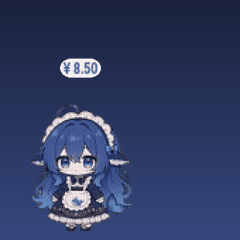

# DeepSeek 鲸鱼娘 · 像素悬浮桌宠

蓝发女仆装鲸鱼娘，逐帧动画，以小窗 / 悬浮球形式浮在桌面上，头顶显示 DeepSeek 账号实时余额。



## 素材来源

像素套图取自 [1TRYOUT/dsh-whale-pixel-pet](https://github.com/1TRYOUT/dsh-whale-pixel-pet)（MIT），仓库内提供了待机、点击回应、拖拽悬空、下蹲压缩等一整套动画。
角色形象版权归原作者，**商用前请自行确认授权**。

`tools/build_assets.py` 会把 GIF 转成带内边距的精灵表（`assets/*_sheet.png`），
运行时用 `tex_coords` 切片播放，像素采样固定为最近邻。

## 交互

| 操作 | 反应 |
| --- | --- |
| 轻点 | 压一下 + 开心动画 |
| 长按 | 下蹲压缩循环 |
| 拖拽 | 悬空拖拽动画，身体倾斜 |
| 甩出 | 惯性滑行，撞边反弹 |
| 点价签 | 立即刷新余额 |

余额每 60 秒自动刷新，低于 ¥5 变橙色。没配置 key 时价签自动隐藏。

## 配置 API Key

**手机上最简单**：把 key 复制到剪贴板，打开 App（或点一下头顶价签），会自动领取并保存。

桌面端任选一种：

```bash
export DEEPSEEK_API_KEY=sk-xxx      # 环境变量
python3 whale_pet.py --key=sk-xxx   # 命令行
echo sk-xxx > deepseek_key.txt      # 同目录文件
```

没配 key 时价签显示灰色的 `key?`，不影响桌宠本身。

## 本地运行

```bash
pip install kivy pillow
python3 whale_pet.py
```

## 出 APK

仓库已带 `.github/workflows/build-apk.yml`。推到 GitHub 后：

1. 打开 **Actions → build-apk**
2. 等 20~40 分钟
3. 下载 `whale-pet-apk` 压缩包里的 APK

首次启动要在系统设置里给 App 打开 **「显示在其他应用上层」**，桌宠才会变成桌面悬浮球。

本地打包需要 x86_64 Linux + JDK17 + 约 20GB 磁盘：

```bash
pip install buildozer cython==0.29.36
buildozer -v android debug     # 产物在 bin/
```

## 文件

- `whale_pet.py` —— 渲染、物理、触摸、悬浮窗、余额
- `assets/` —— 精灵表与动画元数据
- `tools/build_assets.py` —— GIF → 精灵表
- `preview.py` / `demo_anim.py` —— 离线验收用
